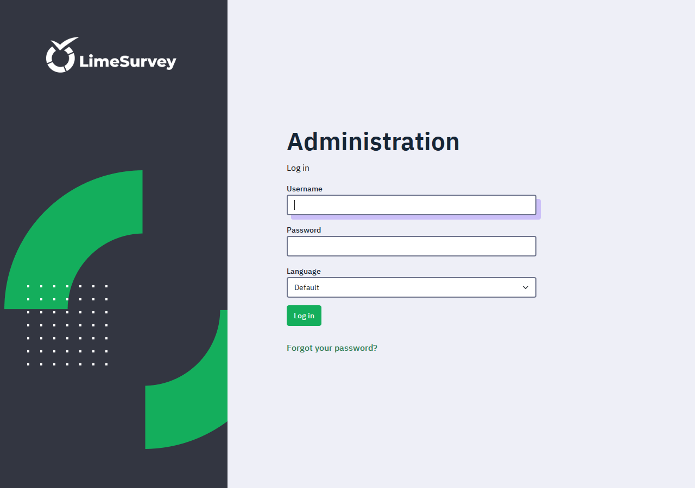

# LimeSurvey

LimeSurvey is a free, open-source survey platform — a self-hosted
alternative to SurveyMonkey, Typeform, and Qualtrics. Build surveys with
branching logic, question groups, and conditions; invite participants with
tokens; and analyse responses with built-in statistics and exports.
Deploy it on Railway in one click: the app plus a PostgreSQL 16
companion, persistent volumes for uploads and the database, and a
zero-field deploy form. The admin account is created automatically on
first boot — sign in with username `admin` and the generated password.

## Deploy and Host

One click deploys two services: the LimeSurvey 7.8 app (PHP + Apache,
wrapping the maintained `martialblog/limesurvey` image, pinned by digest)
and a PostgreSQL 16 companion over Railway's private network. The app
waits for the database, generates its configuration from the environment,
and runs LimeSurvey's own CLI installer on first boot only — creating the
schema and the admin account — so redeploys and restarts never wipe or
re-install anything. Railway terminates TLS at the edge; the app's plain
HTTP listener serves the full UI and API.

## Why Deploy

- **Full survey engine, no subscription:** unlimited surveys, questions,
  and responses on your own infrastructure.
- **Branching and logic:** conditions, relevance equations, question
  groups, quotas, and assessments without a paid tier.
- **Participant management:** token tables, invitation and reminder
  emails, and closed-access surveys.
- **Analysis built in:** response statistics, charts, and CSV/SPSS/R
  exports — no third-party analytics needed.
- **Privacy:** responses live in your own PostgreSQL database, not on a
  survey vendor's servers.

## Common Use Cases

- Customer and employee feedback surveys
- Academic and market research questionnaires
- Event registration and evaluation forms
- Course and training assessments
- Community polls with token-controlled access

## Configuration

Only two values are generated at deploy time; everything else is baked
into the images or derived at boot, so the deploy form has zero fields to
fill in.

| Variable | Service | Default | What it does |
| --- | --- | --- | --- |
| `ADMIN_PASSWORD` | limesurvey | `${{secret(32)}}` | Initial admin password (username `admin`). Change it after first login. |
| `DB_HOST` | limesurvey | `${{postgres.RAILWAY_PRIVATE_DOMAIN}}` | Companion host on the private network. |
| `DB_PASSWORD` | limesurvey | `${{postgres.POSTGRES_PASSWORD}}` | Database password, auto-wired from the companion. |
| `POSTGRES_PASSWORD` | postgres | `${{secret(32)}}` | Database password for the companion. |

Baked into the app image (change only if you fork the repo):

| Variable | Default | What it does |
| --- | --- | --- |
| `DB_TYPE` | `pgsql` | Database driver (PostgreSQL). |
| `DB_PORT` | `5432` | Companion port. |
| `DB_NAME` / `DB_USERNAME` | `limesurvey` | Database name and user. |
| `DB_TABLE_PREFIX` | `lime_` | Prefix for LimeSurvey tables. |
| `ADMIN_NAME` | `Railway Administrator` | Display name of the initial admin. |
| `ADMIN_EMAIL` | `admin@example.com` | Email of the initial admin (used for password resets). |
| `DEBUG` | `0` | LimeSurvey debug level. |
| `PUBLIC_URL` | derived at boot | Canonical public URL, taken from the live Railway domain. A broken or unresolved value is ignored (see `entrypoint.sh`). |

Applicable upstream variables (from the `martialblog/limesurvey` image)
you can set on the service after deploy if you need them:

| Variable | Default | What it does |
| --- | --- | --- |
| `BASE_URL` | — | Application base URL (sub-path installs). |
| `HOST_INFO` | — | Enforced request host (reverse-proxy setups). |
| `URL_FORMAT` | `path` | URL style (`path` or `get`). |
| `SHOW_SCRIPT_NAME` | `true` | Whether `index.php` appears in URLs. |
| `TABLE_SESSION` | — | Persist sessions in the database when set. |
| `DEBUG_SQL` | `0` | SQL debug level. |
| `ENCRYPT_KEYPAIR` / `ENCRYPT_PUBLIC_KEY` / `ENCRYPT_SECRET_KEY` / `ENCRYPT_NONCE` / `ENCRYPT_SECRET_BOX_KEY` | — | Data-encryption keys. Leave unset: the wrapper persists the app-generated `security.php` on the volume instead, which is the upstream-recommended durable path. |
| `LISTEN_PORT` | `${PORT}` | Apache listen port; the wrapper maps Railway's `PORT` here. |

## Persistence

- App volume `/data`: survey uploads (`upload/`) and the generated
  `security.php` (data-encryption keys — must survive restarts).
- Database volume `/var/lib/postgresql/data`: the full PostgreSQL data
  directory (with `PGDATA` in a subdirectory, as the official image
  requires on Railway volumes).

## Details

- Runtime: PHP 8.5 + Apache (upstream image), PostgreSQL 16 companion.
- Port: Railway's injected `PORT`, mapped to Apache at boot.
- Healthcheck: `/healthcheck` (a static extensionless probe file shipped
  in the image; Railway's API rejects healthcheck paths containing a
  dot, so the login page's `/index.php/...` form cannot be used, and
  the no-script-name admin route returned a 301 redirect under
  Railway's probe. The probe proves the web server is up; the login
  page plus the full survey workflow are verified by e2e instead).
  The admin login page itself is `/index.php/admin/authentication/sa/login`
  and returns 200 without authentication.
- Upstream: [LimeSurvey](https://www.limesurvey.org/) 7.8.0, GPL-2.0-or-later.
- Image: `martialblog/limesurvey:7.8.0-261026-apache`, pinned by digest.

### Deployment Dependencies

- Railway Hobby plan or higher (two services, two volumes).
- Memory at rest: roughly 300–500 MB for the app plus PostgreSQL; the
  app is always on, so usage accrues while idle as well as under load.
