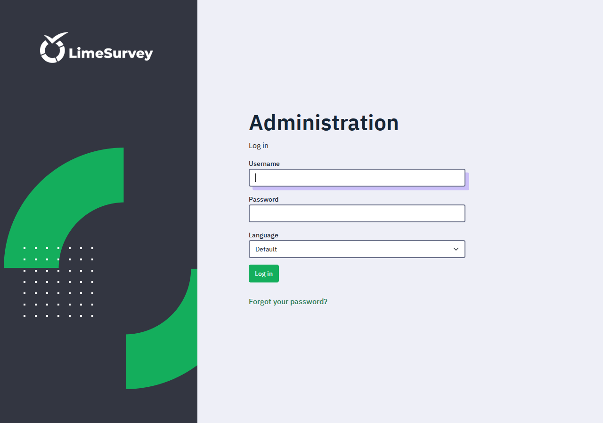

# Deploy and Host

LimeSurvey is a free, open-source survey platform — a self-hosted
alternative to SurveyMonkey, Typeform, and Qualtrics. Deploy it on Railway
in one click: the app plus a PostgreSQL 16 companion, persistent volumes
for uploads and the database, and a zero-field deploy form. The admin
account is created automatically on first boot — sign in with username
`admin` and the generated password.

## About Hosting

Hosting LimeSurvey on Railway means a PHP + Apache app service talking to
a PostgreSQL 16 companion over the private network, with the database on
a persistent volume and survey uploads plus the generated encryption
config on an app volume. The wrapper waits for the database, generates
its configuration from the environment, and runs LimeSurvey's own CLI
installer on first boot only — creating the schema and the admin account
— so redeploys and restarts never wipe or re-install anything. The public
URL is derived at boot from the live Railway domain, so survey links and
invitations always carry the correct address. Railway terminates TLS at
the edge; the app's plain HTTP listener serves the full UI and API.

## Why Deploy

- **Full survey engine, no subscription:** unlimited surveys, questions,
  and responses on your own infrastructure.
- **Branching and logic:** conditions, relevance equations, question
  groups, quotas, and assessments without a paid tier.
- **Participant management:** token tables, invitation and reminder
  emails, and closed-access surveys.
- **Analysis built in:** response statistics, charts, and CSV/SPSS/R
  exports — no third-party analytics needed.
- **Privacy:** responses live in your own PostgreSQL database, not on a
  survey vendor's servers.

## Common Use Cases

- Customer and employee feedback surveys
- Academic and market research questionnaires
- Event registration and evaluation forms
- Course and training assessments
- Community polls with token-controlled access

## Dependencies for

LimeSurvey needs a PostgreSQL database and a writable upload directory;
both are provided by this template (companion service plus volumes), so
there is nothing else to provision.

### Deployment Dependencies

- Railway Hobby plan or higher (two services, two volumes).
- Memory at rest: roughly 300–500 MB for the app plus PostgreSQL; the
  app is always on, so usage accrues while idle as well as under load.
- Env var reference: `ADMIN_PASSWORD` (generated, initial admin
  password), `DB_HOST` (auto-wired companion host), `DB_PASSWORD`
  (auto-wired from the companion),
  `POSTGRES_PASSWORD` (generated, companion password). Baked constants:
  `DB_TYPE=pgsql`, `DB_PORT=5432`, `DB_NAME`/`DB_USERNAME=limesurvey`,
  `DB_TABLE_PREFIX=lime_`, `ADMIN_NAME`, `ADMIN_EMAIL`, `DEBUG=0`.
  Optional upstream settings after deploy: `BASE_URL`, `HOST_INFO`,
  `URL_FORMAT`, `SHOW_SCRIPT_NAME`, `TABLE_SESSION`, `DEBUG_SQL`, and
  the `ENCRYPT_*` keys (leave unset — the wrapper persists the
  app-generated `security.php` on the volume instead).
